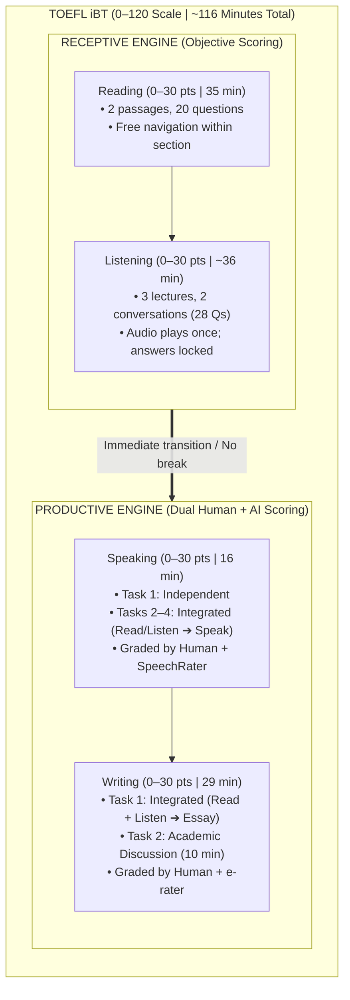

# TOEFL iBT Architecture & Scoring

## 1. Core Overview
The modern TOEFL iBT (updated post-July 2023) is a continuous, under-2-hour computer-delivered test measuring academic English proficiency on a **0–120 scale**.

---

## 2. The Fundamental Division

All tasks fall into two cognitive modes:

1. **Receptive Intake (Reading & Listening):**
   - Pure comprehension of university-level material.
   - Closed-ended, deterministic scoring (0–30 scaled points).
   - Occurs in the first half of the test.
2. **Productive Output (Speaking & Writing):**
   - Active generation and multimodal synthesis.
   - Evaluated by **both certified human raters and proprietary AI scoring engines** (SpeechRater / e-rater).
   - Occurs in the second half of the test.

---

## 3. Section Specifications Comparison

| Dimension | Reading | Listening | Speaking | Writing |
| :--- | :--- | :--- | :--- | :--- |
| **Time Limit** | 35 minutes | ~36 minutes | ~16 minutes | 29 minutes |
| **Volume** | 2 passages, 20 Qs | 3 lectures + 2 conversations (28 Qs) | 4 tasks | 2 tasks |
| **Task Models** | Receptive comprehension | Receptive comprehension | 1 Independent + 3 Integrated | 1 Integrated + 1 Academic Discussion |
| **Navigation** | Free back-and-forth review | Audio once; permanently locked | Fixed countdown timer per task | Dedicated task clocks (20m / 10m) |
| **Evaluation** | Automated answer key | Automated answer key | Human Rater + **SpeechRater** | Human Rater + **e-rater** |

---

## 4. Key Structural Rules
- **No Experimental Filler:** Every single question on the test is scored. There are no unscored experimental sections.
- **Continuous Sitting:** There is **no scheduled 10-minute break** between Listening and Speaking.
- **Multimodal Dependency:** Listening and note-taking ability directly impacts **3 out of 4 sections** (Listening itself, Speaking Tasks 2–4, and Writing Task 1).

---
*Related Notes:*
- [[2. 14-day-crash-plan|14-Day Crash Plan]]
- [[3. speaking-skeletons|Speaking Skeletons]]
- [[4. writing-skeletons|Writing Skeletons]]
- [[5. reading-elimination|Reading Elimination]]
- [[6. listening-mechanics|Listening Mechanics]]
