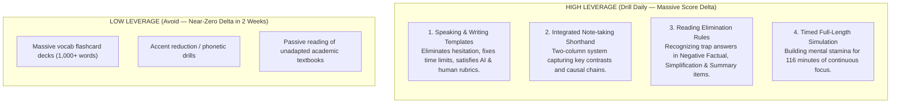
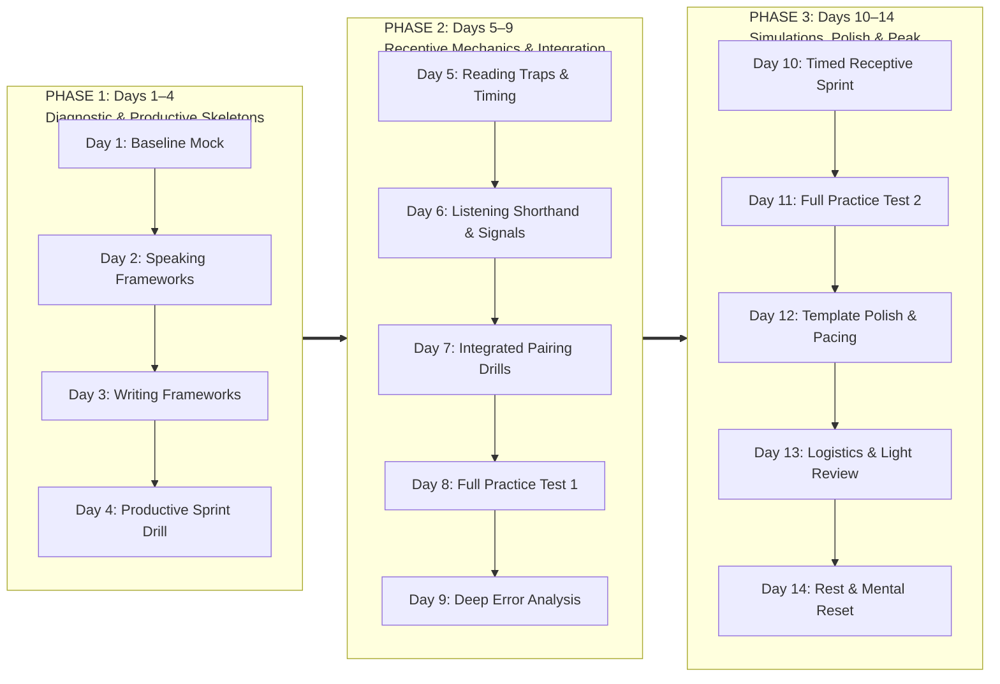

# 14-Day Tactical Study Roadmap

## 1. The Short-Window Leverage Principle
When preparing with a runway of $\le 2$ weeks, **raw language acquisition has flat returns**. Score increases come almost exclusively from **mastering test mechanics, structural frameworks, and rubric fulfillment**.

---

## 2. The 3-Phase Sprint Architecture

---

## 3. Daily Action Breakdown

### Phase 1: Diagnostic & Productive Skeletons (Days 1–4)
- **Day 1 — Baseline Diagnostic:**
  - Complete an official ETS practice test under strict timing.
  - Record your four section scores (0–30) to pinpoint your primary liability.
- **Day 2 — Speaking Frameworks ([[3. speaking-skeletons|Details]]):**
  - Lock in the skeletons for Task 1 (Independent) and Tasks 2–4 (Integrated).
  - Practice with a stopwatch: 15s/30s prep, 45s/60s delivery.
- **Day 3 — Writing Frameworks ([[4. writing-skeletons|Details]]):**
  - Master the 4-paragraph Integrated skeleton (20m) and the 10-minute Academic Discussion formula.
- **Day 4 — Productive Sprint Drill:**
  - Deliver 4 speaking tasks and 2 essays back-to-back under strict real-time timers.

### Phase 2: Receptive Mechanics & Integration (Days 5–9)
- **Day 5 — Reading Elimination & Traps ([[5. reading-elimination|Details]]):**
  - Drill high-value items: Negative Factual, Sentence Simplification, and the 2-point Prose Summary.
  - Enforce the **17.5-minute per passage** pacing rule.
- **Day 6 — Listening Shorthand & Signals ([[6. listening-mechanics|Details]]):**
  - Drill two-column notes and auditory signal detection across lectures and conversations.
- **Day 7 — Integrated Synthesis Drills:**
  - Pair listening notes directly into Speaking Tasks 2–4 and Writing Task 1.
- **Day 8 — Full-Length Practice Test 1:**
  - Complete an uninterrupted 116-minute simulation (zero pauses, real exam conditions).
- **Day 9 — Deep Error Analysis:**
  - Classify every error: *timing lapse, trap distractor, or missed lecture detail?* Adjust tactics accordingly.

### Phase 3: Simulations, Polish & Peaking (Days 10–14)
- **Day 10 — Timed Receptive Sprint:**
  - 35 min Reading + 36 min Listening back-to-back.
- **Day 11 — Full-Length Practice Test 2:**
  - Final full dress rehearsal using scratch paper/whiteboard system.
- **Day 12 — Template Polish & Pacing:**
  - Polish transitional variety, eliminate dead pauses and filler words.
- **Day 13 — Logistics & Equipment Check:**
  - Verify test center rules / Home Edition environment. Review template cheat sheets.
- **Day 14 — Rest & Mental Reset:**
  - Zero heavy testing. Rest working memory to arrive at peak alertness.

---
*Related Notes:*
- [[1. toefl-architecture|Exam Architecture]]
- [[3. speaking-skeletons|Speaking Skeletons]]
- [[4. writing-skeletons|Writing Skeletons]]
- [[5. reading-elimination|Reading Elimination]]
- [[6. listening-mechanics|Listening Mechanics]]
