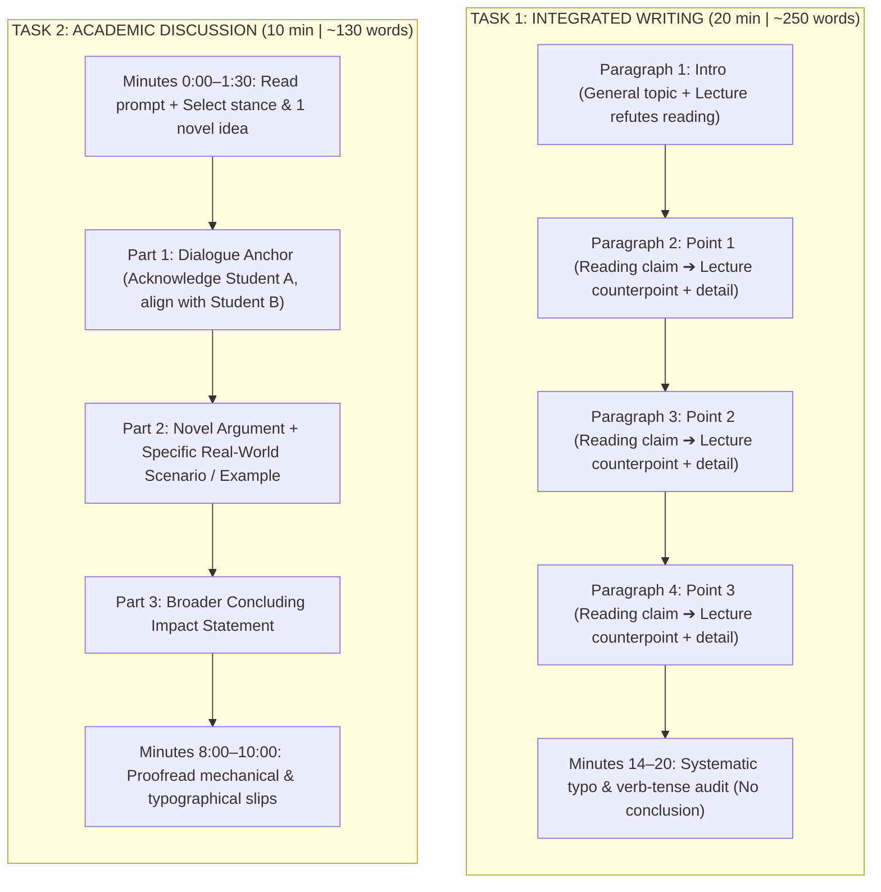

# Writing Skeletons & High-Score Formulas

## 1. Overview
The modern TOEFL Writing section lasts **29 minutes total** across two completely distinct tasks:



---

## 2. Task 1: Integrated Writing (20 Minutes | Target: 220–270 Words)

### Core Rules:
1. **Zero Personal Opinion:** You are 100% an objective reporter.
2. **Omit the Conclusion:** Spending 3 minutes writing a conclusion adds zero points. Use those minutes to fix typos (which **e-rater** heavily penalizes).
3. **1-to-1 Mapping:** The lecture almost always refutes the 3 points in the reading one by one.

### The 4-Paragraph Counterpoint Template:

```markdown
Both the reading passage and the lecture discuss [General Topic]. While the author argues that [Main Reading Claim], the professor casts serious doubt on these claims by providing three counterpoints.

First, the author asserts that [Reading Point 1]. In contrast, the lecturer refutes this by arguing that [Lecture Point 1]. Specifically, the speaker explains that [Lecture detail / mechanism / example]. Consequently, this challenges the reading's assertion regarding [X].

Second, the reading claims that [Reading Point 2]. However, the professor disputes this by contending that [Lecture Point 2]. To support this, the speaker notes that [Lecture detail / example]. This directly contradicts the reading's perspective.

Finally, the author posits that [Reading Point 3]. On the other hand, the lecturer counters this point by stating that [Lecture Point 3]. In particular, the professor explains that [Lecture detail]. This casts significant doubt on the reading's final argument.
```

---

## 3. Task 2: Writing for an Academic Discussion (10 Minutes | Target: 120–150 Words)

### Core Rules:
1. **Do not write multiple paragraphs.** Deliver one dense, unified paragraph.
2. **Anchor into the dialogue:** Mention one of the classmate's viewpoints in your opening sentence.
3. **Contribute a novel angle:** Add a unique supporting point and real-world example not mentioned by either student.

### Time Budget:
- `0:00 – 1:30`: Read prompt, pick stance, decide your 1 fresh example.
- `1:30 – 8:00`: Type the response (~130 words).
- `8:00 – 10:00`: Systematic mechanical audit (typos, subject-verb agreement).

### The 3-Part Fill-in Formula:

```markdown
While I understand [Student A]'s perspective regarding [their topic], I firmly agree with [Student B] that [Your Clear Stance]. 

To take this discussion a step further, [introduce your unique reason/mechanism]. For example, [provide a specific personal experience, current event, or concrete scenario]. In this situation, [explain why your example proves the stance]. 

Therefore, focusing on [Your Stance] not only resolves [immediate problem], but also fosters long-term [broader benefit].
```

---
*Related Notes:*
- [[1. toefl-architecture|Exam Architecture]]
- [[2. 14-day-crash-plan|14-Day Crash Plan]]
- [[3. speaking-skeletons|Speaking Skeletons]]
- [[6. listening-mechanics|Listening Mechanics]]
