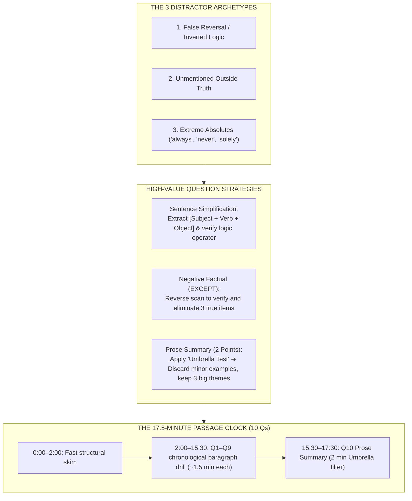

# Reading Elimination Traps & Pacing

## 1. Overview
The Reading section consists of **2 passages (700 words each)**, **20 questions total**, completed within a single **35-minute pool**. 

Because you have full navigation control, you must enforce a strict **17.5-minute per passage clock**.



---

## 2. The 3 Universal Distractor Archetypes

1. **The False Reversal (Distortion):**
   - Uses real passage vocabulary, but inverts the causal relationship or swaps subject and object.
2. **The Unmentioned Truth:**
   - Factually true in the real world (or historical fact), but **completely unmentioned** in the text. *Rule:* If it is not in the text, it is wrong.
3. **The Extreme Absolute:**
   - Injects unauthorized absolutes: *"always"*, *"solely"*, *"impossible"*, *"exclusively"*, *"never"*.

---

## 3. High-Value Question Strategies

### Sentence Simplification (Complex 40+ Word Sentences)
- **Step 1:** Strip descriptive padding between commas. Extract `[Subject] + [Main Verb] + [Object]`.
- **Step 2:** Identify the core logic operator (**Cause/Effect**, **Contrast**, **Condition**).
- **Rule:** Eliminate any option that alters the logic operator or inverts the subject-verb relationship.

### Negative Factual ("EXCEPT" / "NOT")
- Do not hunt for the "correct" answer directly.
- **The Reverse Scan:** Find and cross off the 3 choices that exist in the paragraph. The remaining unmentioned or contradicted option is your answer.

### The 2-Point Prose Summary Question (Question 10)
- You must select **3 out of 6 options** that express the main ideas.
- **The Core Rule:** Factual truth does not equal correctness! ETS deliberately includes true options that are merely **minor supporting details**.
- **The Umbrella Test:** Ask: *"Could this sentence serve as the main topic heading for an entire paragraph, or is it just a single isolated statistic, date, or example?"*
  - Minor examples (even if 100% true) $\to$ **ELIMINATE**.
  - Major overarching themes $\to$ **SELECT**.

---

## 4. The 17.5-Minute Passage Clock

```
[0:00 – 2:00]   Big-Picture Skim: Title, intro paragraph, and topic sentences.
[2:00 – 15:30]  Questions 1–9: Follow chronological paragraph progression (~1.5m per Q).
[15:30 – 17:30] Question 10 (Prose Summary): Apply the Umbrella Test (worth 2 points!).
```

---
*Related Notes:*
- [[1. toefl-architecture|Exam Architecture]]
- [[2. 14-day-crash-plan|14-Day Crash Plan]]
- [[6. listening-mechanics|Listening Mechanics]]
