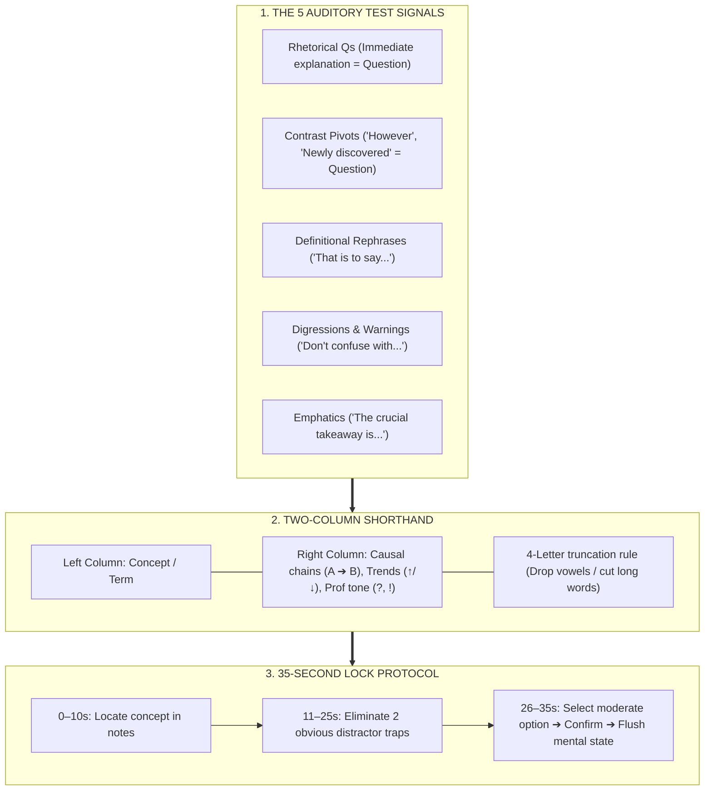

# Listening Mechanics & Note Shorthand

## 1. Overview
The Listening section features **3 academic lectures** (~5 min each, 6 Qs) and **2 campus conversations** (~3 min each, 5 Qs) for a total of **28 questions** across ~36 minutes.

**The Golden Navigation Rule:** Audio plays once. Questions are answered one at a time and **locked permanently** upon submission. The countdown timer runs **only while answering questions**.

---

## 2. The 5 Auditory "Test Signals"
ETS item writers do not test random trivia; they write questions where the professor naturally signals significance:

1. **Rhetorical Questions:** *"Why would this species adapt this way? Well, it turns out that..."* $\to$ The answer following the question is 100% tested.
2. **Contrast Pivots:** *"For years, scientists believed X. But new data shows Y..."* $\to$ ETS tests the new counter-evidence, never the old belief.
3. **Definitional Rephrases:** *"This process is known as X—meaning..."* $\to$ Tests terminology definition and mechanics.
4. **Digressions & Warnings:** *"Don't confuse this with Y..."* $\to$ Often tested as a Replay question or categorization item.
5. **Emphatics:** *"The crucial thing to remember is..."* $\to$ Main point / central mechanism question.

---

## 3. Two-Column Shorthand Toolkit

Avoid auditory lag: do not write full sentences. Write causal symbols and truncated nouns:

| Symbol | Meaning | Example Note |
| :--- | :--- | :--- |
| $\to$ | Causes / leads to / results in | `$\uparrow$ drought $\to$ $\downarrow$ crops` |
| $\neq$ or `vs` | Differs from / contrasts with | `Theory A vs Theory B` |
| $\uparrow$ / $\downarrow$ | Increases / Decreases | `$\uparrow$ temp $\to$ $\downarrow$ ice` |
| `ex` | Example / illustration | `ex: finch beaks` |
| `?` | Skepticism / doubt | `fossils ? (unproven)` |
| `!` | Emphatic takeaway | `! 1st discovery` |

**The 4-Letter Truncation Rule:** Cut words off at 3–4 letters (`photosynthesis` $\to$ `photo`, `population` $\to$ `pop`, `experiment` $\to$ `exp`).

---

## 4. The 35-Second Per-Question Budget
You have roughly **30 to 35 seconds per question**:

- `0–10s`: Read stem and pinpoint concept in notes.
- `11–25s`: Eliminate at least two obvious traps (False Reversals, Absolutes).
- `26–35s`: Pick the most plausible, moderate option. Click Next $\to$ Confirm.
- **The "Flush & Reset" Rule:** Once confirmed, that question is gone forever. Never carry anxiety into the next question.

---
*Related Notes:*
- [[1. toefl-architecture|Exam Architecture]]
- [[2. 14-day-crash-plan|14-Day Crash Plan]]
- [[3. speaking-skeletons|Speaking Skeletons]]
- [[4. writing-skeletons|Writing Skeletons]]
- [[5. reading-elimination|Reading Elimination]]
