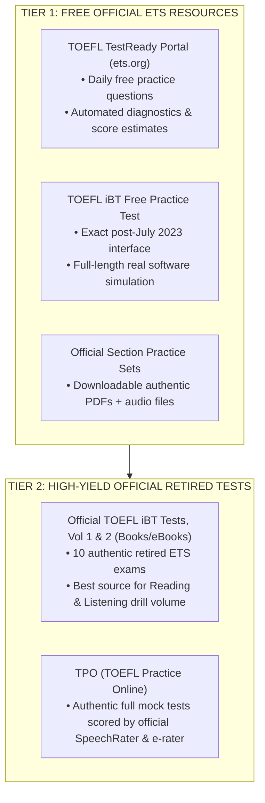

# Official Practice Resources & Test Center Logistics

## 1. Official ETS Practice Materials (The Only Sources You Should Trust)

Never use unofficial third-party mock tests (e.g., Barron's, Kaplan, random YouTube tests) for scoring accuracy—they often use outdated question counts, unrealistic voice actors, or improper scoring rubrics. Stick strictly to authentic ETS materials:



---

## 2. Test Center Day-of Protocol

Taking the test at an official center eliminates technical glitches (webcam drops, proctor disconnections), but introduces specific environmental dynamics you must master:

```
┌────────────────────────────────────────────────────────────────────────┐
│                   OFFICIAL TEST CENTER TIMELINE                        │
├─────────────────┬──────────────────────────────────────────────────────┤
│ 30–45 min Prior │ Security Check & Registration:                       │
│                 │ • Present original, unexpired Passport (must match   │
│                 │   ETS account name letter-for-letter).               │
│                 │ • Lock all electronics, watch, bag in secure locker. │
│                 │ • Photo taken and biometric voice signature recorded.│
├─────────────────┼──────────────────────────────────────────────────────┤
│ Minutes 0 – 35  │ Reading Section:                                     │
│                 │ 2 passages, 20 questions. Self-managed 35-min clock. │
├─────────────────┼──────────────────────────────────────────────────────┤
│ Minutes 35 – 71 │ Listening Section:                                   │
│                 │ 3 lectures, 2 conversations. Audio plays once.       │
│                 │ *Keep headset on to block room noise.*               │
├─────────────────┼──────────────────────────────────────────────────────┤
│ Minute 71       │ ZERO BREAK: Immediate transition to Speaking.        │
├─────────────────┼──────────────────────────────────────────────────────┤
│ Minutes 71 – 87 │ Speaking Section (16 min):                           │
│                 │ Speak clearly into boom mic. Ignore adjacent voices. │
├─────────────────┼──────────────────────────────────────────────────────┤
│ Minutes 87 – 116│ Writing Section (29 min):                            │
│                 │ Task 1 (20 min) ➔ Task 2 (10 min). Submit & review.  │
└─────────────────┴──────────────────────────────────────────────────────┘
```

---

## 3. The 3 Test Center Survival Rules

### 1. The Asynchronous Stagger Trap (Room Noise Defense)
- **The Reality:** Candidates check in and sit down at staggered times. While you are concentrating on your final Listening lecture, someone who started 15 minutes before you may already be speaking loudly into their mic for Speaking Task 1.
- **The Defense:** Keep your headphones on at all times, even during Reading. Adjust the audio volume high during Listening. Anticipate background murmur so it does not startle you.

### 2. Microphone Placement & Acoustic Calibration
- During the check-in and system calibration screen, you will be prompted to speak: *"Describe the city you live in."*
- **Proper positioning:** Position the headset boom mic **2–3 cm away from the side/corner of your mouth**, NOT directly in front of your lips. Placing it right in front causes wind "popping" noises (plosives like *p*, *b*, *t*) that lower SpeechRater acoustic scores.
- **Vocal delivery:** Speak at a firm, confident conversational volume. You do not need to shout, but do not whisper.

### 3. Scratch Paper Economics
- You receive **3 colored sheets of paper and sharpened pencils**.
- If you use our **Two-Column Shorthand** and quadrant system:
  - Sheet 1: Reading notes (bare minimal) + Listening notes (Lectures 1–3, Conversations 1–2).
  - Sheet 2: Speaking notes (divide into 4 quadrants: Task 1, 2, 3, 4).
  - Sheet 3: Writing Task 1 outline (3 points vs 3 counterpoints) + buffer.
- If you run out of space, raise your hand early during a transition screen. The proctor will swap your used sheets for new ones.

---
*Related Notes:*
- [[01-toefl-architecture|Exam Architecture]]
- [[02-14-day-crash-plan|14-Day Crash Plan]]
- [[03-speaking-skeletons|Speaking Skeletons]]
- [[04-writing-skeletons|Writing Skeletons]]
- [[05-reading-elimination|Reading Elimination]]
- [[06-listening-mechanics|Listening Mechanics]]
