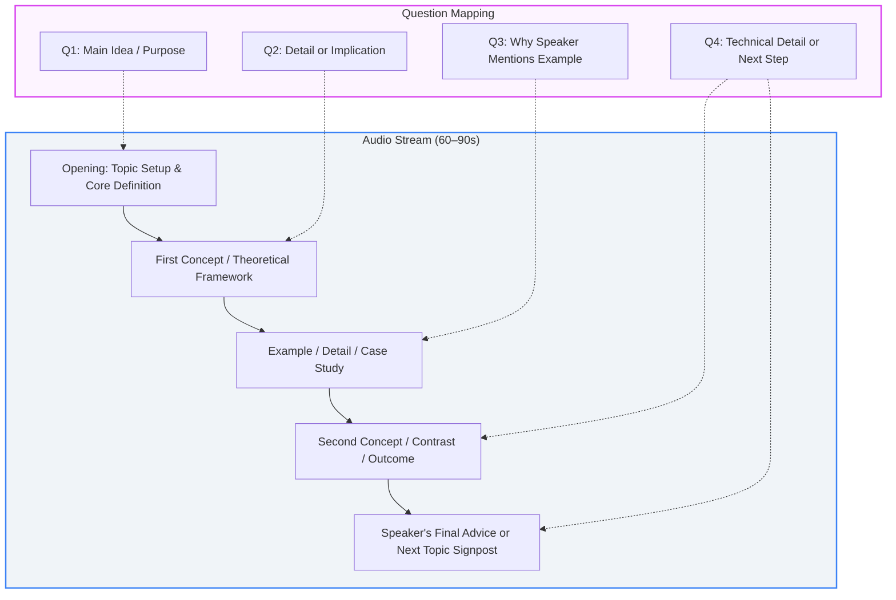
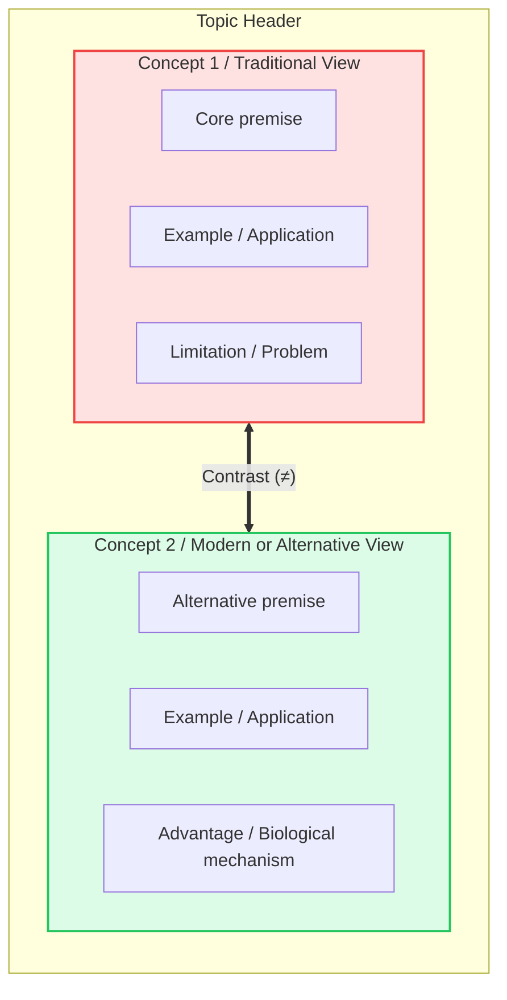
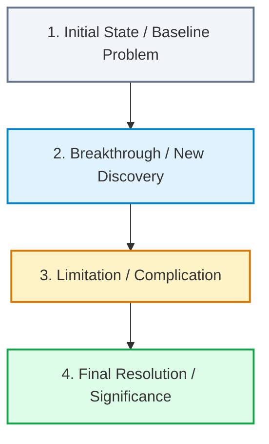

# Listening: how to improve

> Records and exact answers are in [[logs/listening]]. This file is the playbook: dashboard, note-taking frameworks, failure modes, execution checks, and the redo queue.

## Dashboard (as of 2026-10-21)
- **Score so far:** **214 / 225** (95.1%) across 7 tests (12 Type D questions pending across T1 M2, T2 M1, T2 M2).
- **Scaled score:** **28.53 / 30** (linear $30 \times \text{raw} / \text{total}$).
- **Tentative ETS Band:** **Band 6** (ETS *Score Scale Update 2026*, Table 6, Listening column: 28–30 = 6, 26–27 = 5.5). Still tentative: 12 Type D questions are unattempted, and the linear step is my assumption.
- **Per-type breakdown:**
  - Type A (Listen and Choose a Response): **110 / 112** (98.2%) · 2 misses
  - Type B (Listen to a Conversation): **41 / 41** (100.0%) · 0 misses (T6 M1 Q10 unscored)
  - Type C (Listen to an Announcement): **25 / 28** (89.3%) · 3 misses
  - Type D (Listen to an Academic Talk): **38 / 44** (86.4%) · 6 misses across 11 talks

---

## Note-Taking Playbook for Academic Talks (Type D)

Official ETS guideline (*`guide-lesson-listening.pdf`*, Lesson 1): **Question 1 tests the entire talk (Main Idea/Gist), while Questions 2, 3, and 4 strictly follow the chronological timeline of the lecture.** Scratch paper must mirror this timeline.

### 1. The Chronological Mental Model



---

### 2. Framework A: The Contrast T-Chart (For Comparison Talks)
Over half of TOEFL talks contrast two mechanisms, species, or theories (e.g. *Hard vs. Soft Fascination*, *Classical vs. Behavioral Economics*). Divide scratch paper into two parallel columns:



#### Scratch-Paper Layout Example:
```text
TOPIC: 2 Types of Fascination (Attention)
---------------------------------------------------------------
HARD FASCINATION              | SOFT FASCINATION
---------------------------------------------------------------
• Intense focus, 0 outside    | • Effortless, mind wanders
• Ex: Thriller movie, games   | • Ex: Walk in park -> dinner
• Result: Mental fatigue      | • Result: Engages DMN -> heals
---------------------------------------------------------------
TAKEAWAY: Rest mind? Turn off screens -> walk in nature
```

---

### 3. Framework B: The Linear Step Flow (For History & Science Processes)
Used when a talk traces a discovery, historical progression, or biological chain reaction (e.g. *Photography evolution*, *Nanozyme development*).



#### Scratch-Paper Layout Example:
```text
TOPIC: Photography Evolution
1. Early: Camera obscura -> can project, can't fix image
2. Niépce: Bitumen on pewter -> Problem: 8-hr exposure!
3. Daguerre: Silver plate + vapor -> minutes only
4. Result: Portraits available to public (not just painters)
```

---

### 4. Fast-Shorthand & Symbol Lexicon

| Symbol / Mark | Meaning | Spoken Triggers |
| :---: | :--- | :--- |
| `→` | Leads to / results in / causes | *"causes", "leads to", "produces", "as a result"* |
| `≠` or `vs` | Contrast / opposite | *"however", "unlike", "on the other hand", "whereas"* |
| `↑` / `↓` | Increase / Decrease | *"boosts", "rises", "depletes", "drops", "reduces"* |
| `∵` / `∴` | Because / Therefore | *"since", "due to" / "so", "consequently", "thus"* |
| `Ex:` | Example / Case study | *"for instance", "such as", "take for example"* |
| `Def:` | Definition of technical term | *"which means", "known as", "refers to"* |
| `+` / `-` | Advantage / Disadvantage | *"benefit", "effective" / "flaw", "limitation", "drawback"* |
| `Q:` | Central problem / research question | *"researchers wondered", "the key puzzle was"* |

---

### 5. The 3 Golden Rules for Exam-Mode Scratch Paper

1. **Nouns, Verbs, and Relations Only:** Never write complete grammar. Write `Soft fasc -> DMN -> heal fatigue`, not *"The professor said soft fascination engages DMN."*
2. **Pencils Down During Transition Words:** When you hear *"However"*, *"What surprised researchers"*, or *"Next, we will examine"*, keep your eyes up. Listen to the entire clause before writing.
3. **Partition Paper into 4 Quadrants:** Divide each scratch page into 4 quadrants before the section starts—one quadrant per talk. Keeps notes clean and prevents overlap.

---

## Failure Modes Diagnosed in Practice

- **L1: Sub-Detail or Cliché Chosen as Main Idea (Q1):** Selecting a minor sub-example from the second half (e.g. *cognitive training* in T5 M1 Q15) or an unstated textbook cliché (e.g. *how it developed over time* in T4 M2 Q13) instead of the explicit definition in sentences 1–2.
- **L2: Component vs. Whole Confusion:** Selecting the metric or definition of a sub-part instead of the umbrella concept (e.g. choosing *greenhouse gas* for *ecological footprint* instead of *carbon footprint* in T6 M2 Q14; or choosing *plastics* for nanozyme cleanup in T5 M2 Q16).
- **L3: Missing the Final Transition Pivot ("Discuss Next"):** Grabbing a prominent noun from sentence $N-1$ (e.g. *policymakers*) instead of the forward-looking signpost in the final sentence (*"Next, we will examine nudges -> help people reach better decisions"* in T4 M2 Q16).
- **L4: Opposite Polarity / Intent in Examples:** Treating an example of irrational human error as ideal or rational practice (e.g. choosing *importance of rational decision-making* when investors hold losing stocks due to *loss aversion* in T4 M2 Q15).
- **L5: Inventing Context on Statements (Type A):** Building an imagined backstory to justify a distractor rather than matching conversational alignment / acknowledgement (T2 M1 Q8, T6 M1 Q4).
- **L6: Word-Salad Distractor in Announcements (Type C):** Choosing options with prominent topical keywords (*volunteer*, *science students*) rather than checking whether the option actually restates the action (T2 M2 Q12, T3 M1 Q13).

---

## Execution Checklists by Task Type

### Academic Talks (Type D)
- [ ] **Q1 Main Idea:** Check sentences 1–2. Match the core definition. Reject sub-examples and unstated "development over time" history.
- [ ] **"Why mention X?":** Trace up to the parent concept. If the example shows an error, look for the bias/flaw, not a positive recommendation.
- [ ] **"Discuss next":** Anchor exclusively to the *very last sentence*. Ignore sentence $N-1$.
- [ ] **Whole vs. Part:** When an umbrella term is split into sub-components, keep their separate definitions clear in your notes.
- [ ] **Chronological match:** Remember Q2, Q3, Q4 strictly follow the audio sequence.

### Announcements (Type C)
- [ ] **Core Action:** Note Who $\rightarrow$ What $\rightarrow$ When/Where.
- [ ] **Avoid Keyword Anchors:** Do not pick an option solely because it repeats a vivid word (*science*, *volunteer*). Look for paraphrased actions (*attend*, *participate*).
- [ ] **Sequence Check:** In schedule changes, verify who moves to which day and who remains.

### Conversations (Type B)
- [ ] **Problem $\rightarrow$ Obstacle $\rightarrow$ Resolution:** Identify the initial request/concern, the complication, and the final agreed next step.

### Response (Type A)
- [ ] **Speech Act First:** Identify question vs. statement. Match social function (greeting $\rightarrow$ greeting, statement $\rightarrow$ acknowledgement, suggestion $\rightarrow$ acceptance/counter). Never invent a scenario.

---

## Redo Queue
- **Type D:**
  - T4 M2 (Q13, Q15, Q16) — Behavioral Economics cascade.
  - T5 M1 (Q15) — Neuroplasticity main idea vs. cognitive training.
  - T5 M2 (Q16) — Nanozymes in environmental cleanup vs. plastics.
  - T6 M2 (Q14) — Ecological footprint vs. carbon footprint.
  *Pass condition:* Replay audio, write the single deciding sentence, and explain why the distractor was a sub-detail, component confusion, or wrong sentence.
- **Unattempted Type D Talks:** T1 M2, T2 M1, T2 M2 (complete in exam mode on `practice/2d. listen-to-academic-talk.html`).
- **Type C:** T2 M2 Q12, T3 M1 Q13, T7 M1 Q14.
  *Pass condition:* Replay audio and write the one sentence that proves the key; state why the chosen distractor has no audio support.
- **Type A:** T2 M1 Q8, T6 M1 Q4.
  *Pass condition:* State why the key is the only valid adjacency pair without inventing external context.
